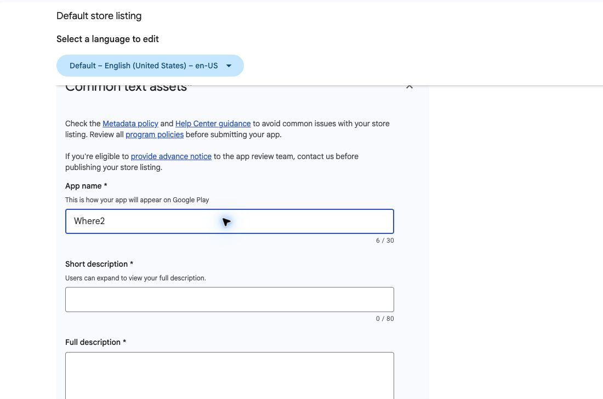
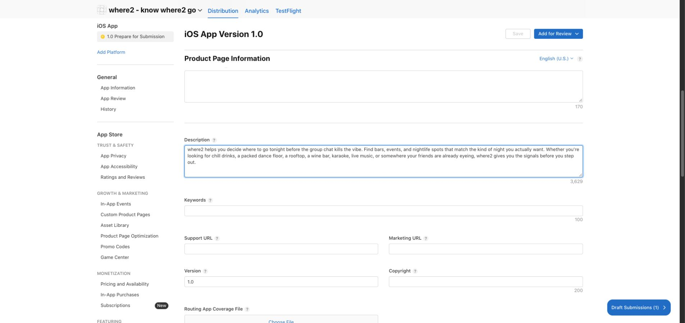
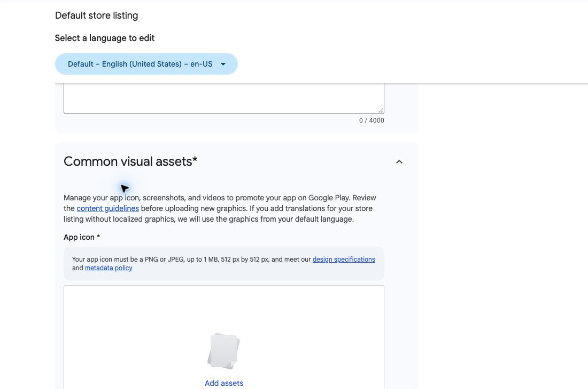
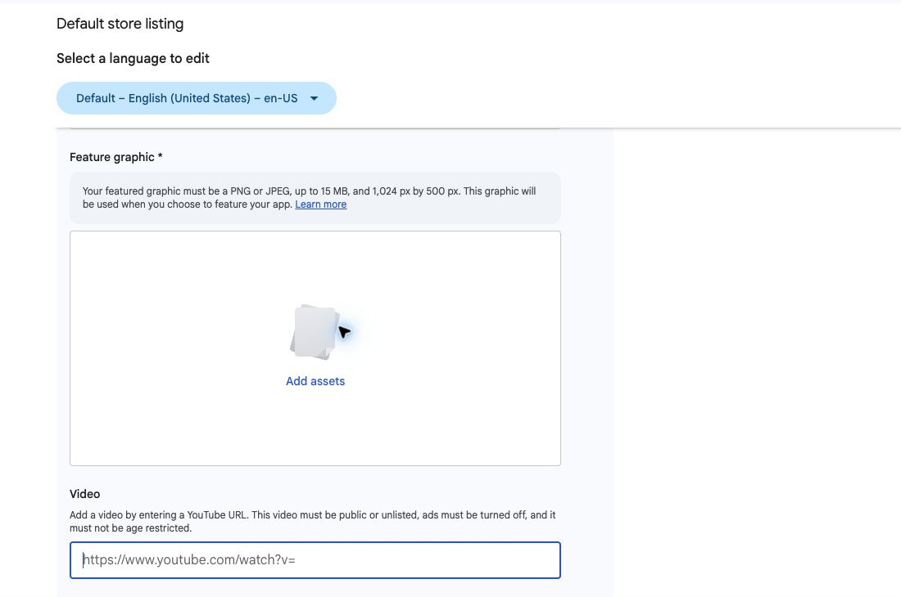
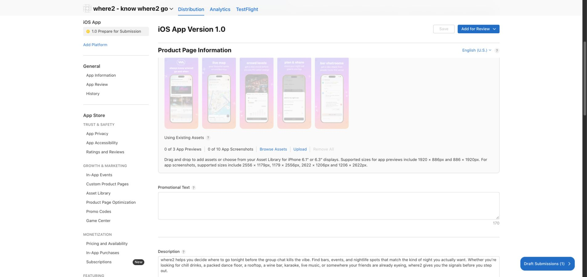
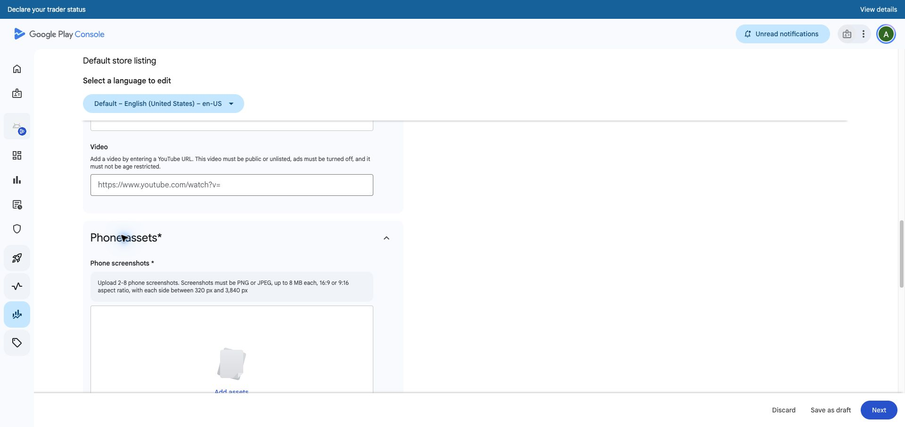
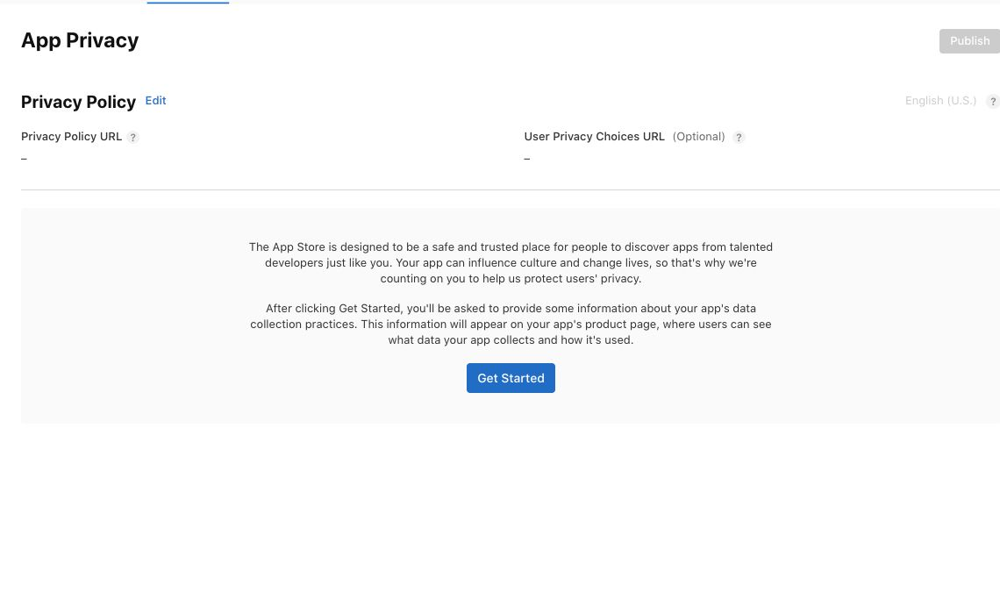
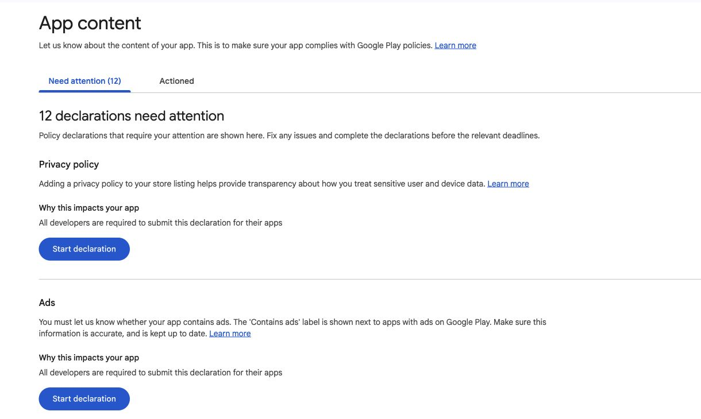
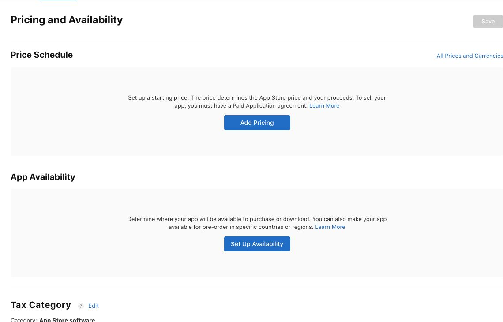

# Where2 Store Listing Client Questionnaire

Please complete this file so we can prepare the Apple App Store and Google Play listings, submit the app for review, and agree on the launch details. Enter approved customer-facing text exactly as it should appear. Add links to assets rather than embedding or uploading the assets into this file.

## How to complete this file

**Public sharing copy:** Anyone with this link can read the questionnaire and reference screenshots. Complete a downloaded or private copy and return it privately. Keep confidential answers and restricted asset links out of public commits and issues.

1. Download this file using GitHub’s Raw or download option, complete it in a text editor, and return the same file privately. Replace each `TO COMPLETE` with your answer. To work in GitHub, use a private copy; do not post completed client answers in this public repository.
2. Use `N/A — reason` for anything that does not apply. Use `Pending — owner — due date` when an answer or asset is outstanding. Do not leave unanswered fields blank.
3. For each asset, paste a downloadable Google Drive, Dropbox, OneDrive, Figma, or equivalent link. Give the delivery team access. Include editable source files and final exports where available, named by platform, language, device, and version.
4. Repeat the language, screenshot, product, and data-practice rows as needed. Long descriptions can be typed directly into the response blocks below; paragraphs do not need to fit in a table cell.
5. Do not enter passwords, one-time codes, private keys, signing files, payment details, or identity documents here. For reviewer credentials or private verification records, provide a reference to the agreed secure delivery channel. Repository history retains earlier edits.

**Scope:** The questions include listing content and the client decisions needed for submission. Some console declarations depend on the app's features and countries. The client supplies business facts and approvals; engineering confirms implemented behavior and technical declarations. A requested field is not necessarily mandatory in both stores.

## Current console review and client priorities

**Screenshot guide:** The console screenshots below were captured on 13 November 2026 and are visual references, not fields to fill in. Click an image in GitHub to view it at full size. The app identity screenshot is omitted from this public copy. Enter your answers in this file and provide links to your own approved assets. Console settings were not changed while taking these images.

Reviewed the Where2 app records in both consoles on 13 November 2026. The values below are existing configuration for confirmation, not a statement that the listing is approved. No console fields were changed during this review. Complete all answer fields, including confirming or replacing existing values.

| Area | Apple App Store Connect | Google Play Console | Client action |
| --- | --- | --- | --- |
| App record | Where2 iOS app record reviewed | Where2 Android app record reviewed | Confirm the intended records and publishing entity privately |
| Listing state | iOS version `1.0`, Prepare for Submission; no build selected on the version page | Draft app; production inactive | Confirm release scope and planned launch |
| Name and language | `where2 - know where2 go`; English U.S. | `Where2`; English United States `en-US` | Confirm whether the names should differ between stores |
| Categories | Food & Drink primary; Social Networking secondary | App type is App; category not selected; no tags displayed | Confirm Apple categories and supply Google category and tags |
| Copy | Description exists; subtitle, promotional text, keywords, support URL, marketing URL, and copyright are empty | Short description and full description are empty | Approve or rewrite the existing Apple description and supply missing copy |
| Brand and visual assets | Header tab shows one existing asset; iPhone tab shows five existing image previews, Using Existing Assets, and a counter of 0 of 10 screenshots; final attachment must be verified | Icon, feature graphic, phone screenshots, and video are empty | Supply approved source links for both stores and confirm the final images and order |
| Tablet assets | iPad 13-inch slot shows 0 screenshots and 0 previews | 7-inch and 10-inch tablet sections show empty upload controls, marked required in the current form | Confirm tablet support with engineering and supply applicable screenshots |
| Privacy | Privacy policy and privacy choices URLs are empty; privacy questionnaire shows Get Started | Privacy policy and Data safety declarations need attention | Provide approved URLs and complete the data-practice answers |
| Ratings and content | Age ratings not set up; Content Rights currently says no third-party content | Content rating, target audience, ads, and other declarations need attention | Confirm age/content answers and correct the rights answer if user or third-party content is present |
| Review access | Sign-in required is checked; account and review-contact fields and notes are empty | Sign in details declaration needs attention | Provide dedicated review access through a secure channel and complete review instructions |
| Pricing and countries | Add Pricing and Set Up Availability are shown | Not reviewed in this pass | Specify intended price and launch countries; team to verify final setup |
| Release options | Automatic release after approval selected; public distribution selected | Production inactive | Confirm release and distribution preferences before submission |
| Additional device distribution | Apple Silicon Mac availability is checked with macOS 26.0 selected; Vision Pro availability is checked, but version 1.0 is shown as incompatible | Additional device assets remain conditional on distribution scope | Confirm whether these device options are intended |
| Accessibility | Accessibility declaration shows Get Started | Not reviewed separately | Approve only tested accessibility claims |
| Account notice | Digital Services Act setup notice shown | Declare your trader status notice shown | Have the account owner confirm business/trader status and complete verification |

Google's dashboard shows **0 of 11 initial setup tasks complete**. Its App content page separately shows **12 declarations needing attention**: Privacy policy, Ads, Sign in details, Content ratings, Target audience and content, Data safety, Advertising ID, Government apps, Financial features, Health apps, Location permissions, and Foreground service permissions. These are different console checklists; both need to be addressed.

Console review references are maintained privately by the delivery team. The official store specifications are linked at the end of this questionnaire.

## 1 Client owner and scope

| Information requested | Client response |
| --- | --- |
| Company or client name | TO COMPLETE |
| Person responsible for completing this questionnaire | TO COMPLETE |
| Business contact email for follow-up | TO COMPLETE |
| Final approver for store copy and assets | TO COMPLETE |
| Legal or privacy approver | TO COMPLETE |
| Target date for returning this completed file | TO COMPLETE |
| Date last updated and questionnaire status | TO COMPLETE |
| Stores in scope — Apple App Store, Google Play, or both | TO COMPLETE |
| New listing, update to an existing listing, transfer, or rebrand | TO COMPLETE |
| Existing Apple App Store listing URL, if any | TO COMPLETE |
| Existing Google Play listing URL, if any | TO COMPLETE |
| Release or campaign this listing supports | TO COMPLETE |
| Which information or assets should remain unchanged from the current listing | TO COMPLETE |
| Is Where2 the final brand name — confirm exact capitalization | TO COMPLETE |

## 2 Publisher and developer accounts

Provide public business information here. Share private verification evidence through the secure channel, not Git.

| Information requested | Client response |
| --- | --- |
| Legal entity that owns and publishes the app | TO COMPLETE |
| Public developer or seller display name requested | TO COMPLETE |
| Company website | TO COMPLETE |
| Public business support email | TO COMPLETE |
| Public business telephone number, with country code, if applicable | TO COMPLETE |
| Public business address or secure reference for verification-only address | TO COMPLETE |
| Apple Developer account exists — organization or individual; enrollment active | TO COMPLETE |
| Apple Account Holder or account administrator contact | TO COMPLETE |
| App Store Connect app record URL and Apple app ID, if already created | TO COMPLETE |
| Apple Team ID and bundle ID, if known — engineering to confirm | TO COMPLETE |
| Apple SKU, if already assigned — internal identifier, not store copy | TO COMPLETE |
| Google Play developer account exists — organization or individual; verification status | TO COMPLETE |
| Google Play account administrator contact | TO COMPLETE |
| Play Console app record URL and package name, if already created | TO COMPLETE |
| Team email addresses to invite and required roles — send invitations through the consoles | TO COMPLETE |
| Outstanding account agreements, identity verification, or access restrictions | TO COMPLETE |
| EU trader status and person responsible for confirming required public business details | TO COMPLETE |
| Other country-specific publisher registrations or business licenses — secure reference | TO COMPLETE |

## 3 Product identity and positioning

### Where these details appear

**Apple app information:** Confirm the current name and categories recorded above, and supply the final subtitle below.

**Google Play text assets:** Provide the short and full descriptions and confirm the name shown here.

| Information requested | Client response |
| --- | --- |
| Apple App Store app name — up to 30 characters | Current: `where2 - know where2 go`. TO COMPLETE — confirm or replace |
| Google Play app name — up to 30 characters | Current: `Where2`. TO COMPLETE — confirm or replace |
| Name displayed under the installed app icon | TO COMPLETE |
| Apple subtitle — up to 30 characters | TO COMPLETE |
| Google Play short description — up to 80 characters | TO COMPLETE |
| Apple promotional text, if wanted — up to 170 characters | TO COMPLETE |
| One-sentence explanation of what the app does | TO COMPLETE |
| Main customer groups and the problem the app solves | TO COMPLETE |
| Three to five benefits to emphasize, in priority order | TO COMPLETE |
| Features available in this release — distinguish consumer and venue-owner features | TO COMPLETE |
| Features that must not be advertised because they are not available yet | TO COMPLETE |
| Brand tone, preferred terminology, and words to avoid | TO COMPLETE |
| Competitor or reference listing URLs — explain what you like | TO COMPLETE |
| Claims, awards, rankings, partnerships, or testimonials requested — include evidence link and permission | TO COMPLETE |
| Copyright owner and year | TO COMPLETE |
| Trademark ownership and permission to use third-party names or content — evidence link | TO COMPLETE |

Text limits above follow [Apple app information](https://developer.apple.com/help/app-store-connect/reference/app-information/app-information/), [Apple version information](https://developer.apple.com/help/app-store-connect/reference/app-information/platform-version-information/), and [Google Play listing fields](https://support.google.com/googleplay/android-developer/answer/9859152?hl=en). Count spaces and punctuation when preparing copy.

## 4 Full descriptions and release notes

### Apple description keywords and URLs

Approve or replace the existing description. Supply the missing keywords, support URL, marketing URL, and copyright in the answer fields below and section 6.

Provide final wording in the file. If you want the delivery team to write it, enter `Please draft` and supply the facts, benefits, and exclusions in section 3. Mark the final version as approved before submission.

### Apple full description

Up to 4,000 characters. Use plain text paragraphs.

**Client response:**

Current Apple description for approval or replacement:

> where2 helps you decide where to go tonight before the group chat kills the vibe. Find bars, events, and nightlife spots that match the kind of night you actually want. Whether you’re looking for chill drinks, a packed dance floor, a rooftop, a wine bar, karaoke, live music, or somewhere your friends are already eyeing, where2 gives you the signals before you step out.

TO COMPLETE — approve this text or replace it with the final description.

### Google Play full description

Up to 4,000 characters. Say `Same as approved Apple description` only if that exact text is suitable for Google Play too.

**Client response:**

TO COMPLETE

### Apple keywords

Provide comma-separated search terms, up to 100 bytes total. For non-English text, byte count can exceed character count.

**Client response:**

TO COMPLETE

### Apple version release notes

For an update, describe what changed in this version. For a first release, enter `First release` and provide any launch message for review.

**Client response:**

TO COMPLETE

### Google Play version release notes

Provide the changes to communicate to Android users, separately for each supported language.

**Client response:**

TO COMPLETE

## 5 Categories search and availability

| Information requested | Client response |
| --- | --- |
| Apple primary category | Current: Food & Drink. TO COMPLETE — confirm or replace |
| Apple secondary category, if wanted | Current: Social Networking. TO COMPLETE — confirm or replace |
| Google Play application type — app or game | TO COMPLETE |
| Google Play category | TO COMPLETE |
| Relevant Google Play tags to consider | TO COMPLETE |
| Intended audience — consumers, venue owners, businesses, or other groups | TO COMPLETE |
| Minimum intended user age and business reason | TO COMPLETE |
| Countries or regions to launch in | TO COMPLETE |
| Countries or regions to exclude and why | TO COMPLETE |
| Cities or areas where the service actually operates | TO COMPLETE |
| Can users outside supported areas use the app — describe their experience | TO COMPLETE |
| Default listing language and locale, for example English United States | TO COMPLETE |
| Other listing languages and locales | TO COMPLETE |
| Languages actually supported inside the app | TO COMPLETE |
| Devices in scope — iPhone, iPad, Android phone, Android tablet, foldables | TO COMPLETE |
| Distribute the iOS app on Apple Silicon Macs — currently enabled with macOS 26.0 selected | TO COMPLETE — confirm or change |
| Distribute the iOS app on Apple Vision Pro — currently checked but version 1.0 shown as incompatible | TO COMPLETE — confirm intended support |
| Other platforms or form factors — TV, Watch, desktop, XR, automotive; otherwise N/A | TO COMPLETE |
| Accessibility features to describe publicly — only features tested in the shipped app | TO COMPLETE |
| Availability restrictions by device, age, membership, invite, or organization | TO COMPLETE |

## 6 Website support legal and app links

Enter the full HTTPS URL and identify the owner who can make changes. Public policy and support pages should be usable by customers and reviewers without a private login.

| URL or decision requested | Client response |
| --- | --- |
| Main product or marketing website | TO COMPLETE |
| Apple marketing URL, if different | TO COMPLETE |
| Customer support page URL | TO COMPLETE |
| Public support email to display in Google Play | TO COMPLETE |
| Public support telephone number to display, if wanted | TO COMPLETE |
| Privacy policy URL | TO COMPLETE |
| User privacy choices or data request URL, if available | TO COMPLETE |
| Terms of service URL | TO COMPLETE |
| End user license agreement — Apple standard EULA or custom EULA; provide custom text or link if used | TO COMPLETE |
| Account deletion request URL for Google Play, if users can create accounts | TO COMPLETE |
| In-app path for deleting an account — screen names and steps | TO COMPLETE |
| Data deletion request URL, if different from account deletion | TO COMPLETE |
| Community guidelines and acceptable-use policy URL, if applicable | TO COMPLETE |
| Child safety standards and safety reporting URL, if applicable | TO COMPLETE |
| Subscription terms, refund or cancellation help URL, if applicable | TO COMPLETE |
| Copyright or abuse reporting contact or page | TO COMPLETE |
| Accessibility statement or accessibility support URL, if available | TO COMPLETE |
| Canonical share-link domain — confirm proposed https://share.thewhere2app.com | TO COMPLETE |
| Web fallback when the app is not installed — landing page or store routing | TO COMPLETE |
| Owner responsible for domain DNS, HTTPS, and hosted association files | TO COMPLETE |
| Social media profile URLs to use in approved marketing content | TO COMPLETE |
| Policy effective dates, legal approver, and outstanding changes | TO COMPLETE |

Account-creation and deletion answers must match the delivered app and website. See [Google account deletion guidance](https://support.google.com/googleplay/android-developer/answer/13327111?hl=en).

## 7 Brand files icons banners and video

### Google Play icon and banner upload areas

**App icon:** The console shows the size and file requirements beside the upload area. Add the approved icon download link in the asset table below.

**Feature graphic and video:** Provide the banner asset link and, if wanted, the YouTube video URL.

**For every row, paste an asset or folder link in the response column.** For folders, identify the approved filename and version. For editable designs, include source access and export access. Use `N/A — reason` for conditional or optional assets.

| Asset requested | Specification or purpose | Client asset link and approved version |
| --- | --- | --- |
| Master brand asset folder | All original artwork and approved exports | TO COMPLETE |
| Brand guidelines | Colors, typography, clear space, naming, usage rules | TO COMPLETE |
| Master logo | Editable vector source and transparent exports | TO COMPLETE |
| Logo variants | Light, dark, monochrome, horizontal, stacked, wordmark | TO COMPLETE |
| Apple app icon source | Editable artwork or Icon Composer project if available; high-resolution square master, preferably 1024 by 1024 PNG for export preparation | TO COMPLETE |
| Apple icon appearance variants | Approved dark or tinted variants, if supplied | TO COMPLETE |
| Android Google Play listing icon | Current console: 512 by 512 PNG or JPEG, up to 1 MB; provide the final store export and editable source | TO COMPLETE |
| Android launcher icon source | Foreground, background, monochrome or adaptive artwork, if supplied | TO COMPLETE |
| Google Play feature graphic or banner | 1024 by 500 JPEG or 24-bit PNG without transparency; current console limit 15 MB | TO COMPLETE |
| Apple product page header artwork | Current console Header tab shows one asset; confirm it or provide a replacement source and export link. UI lists 5244 by 2950 and 3840 by 1646 pixel sizes | TO COMPLETE |
| Apple search results creative assets | Optional separate search-results artwork or video; provide approved sources and final exports if wanted | TO COMPLETE |
| Apple campaign or featuring artwork | Additional optional promotional material; identify the intended placement | TO COMPLETE |
| In-app launch or splash branding | Approved source and exports, if changing | TO COMPLETE |
| Apple app preview video | Optional; provide final video, editable source, poster frame, and language | TO COMPLETE |
| Google Play preview video | Optional YouTube URL and editable source link | TO COMPLETE |
| Video music voiceover and footage rights | Usage permission or licensing evidence | TO COMPLETE |
| Campaign or custom product page artwork | Optional; identify audience and campaign | TO COMPLETE |
| Additional device artwork | TV banners, Watch, XR, automotive, or other assets only if those form factors are in scope | TO COMPLETE |
| Fonts stock images and illustration licenses | Downloadable files or license references | TO COMPLETE |
| Asset access owner and access-expiry date | Who grants access and when links expire | TO COMPLETE |

Google's [preview asset guidance](https://support.google.com/googleplay/android-developer/answer/9866151?hl=en-419) covers the feature graphic and other creative assets. Check final exports against the current console requirements; source artwork alone is not an approved export.

## 8 Screenshots and screenshot copy

### Device screenshot upload areas

**Apple iPhone screenshots:** Existing previews are visible, but the panel says Using Existing Assets and shows 0 of 10 screenshots. Confirm the original asset links, final selection, ordering, and export sizes before submission.

**Google Play phone screenshots:** Supply the final image links and approved order. The console displays the image count, dimensions, aspect ratio, and file limit.

Provide real app screens representing the submitted version. Use sample data with permission, and remove private user information. Supply a separate folder for each platform, device group, orientation, and language. The design team should confirm the exact export sizes before preparing all images.

| Screenshot set requested | Client asset folder link or response |
| --- | --- |
| iPhone screenshots for the current required App Store display slot — current UI accepts portrait 1179 by 2556 or 1206 by 2622, and the corresponding landscape sizes | TO COMPLETE |
| Additional iPhone display or orientation variants, if supplied | TO COMPLETE |
| iPad screenshots, if iPad is supported — current UI accepts portrait 2048 by 2732 or 2064 by 2752, and the corresponding landscape sizes | TO COMPLETE |
| Foldable iPhone or other Apple device variants, if applicable | TO COMPLETE |
| Android phone screenshots — current UI asks for 2 to 8 PNG or JPEG files, up to 8 MB each, aspect ratio 9:16 or 16:9, each side 320 to 3840 pixels | TO COMPLETE |
| Android 7-inch tablet screenshots — current UI allows up to 8 PNG or JPEG files, up to 8 MB each, aspect ratio 9:16 or 16:9, each side 320 to 3840 pixels | TO COMPLETE |
| Android 10-inch tablet screenshots — current UI allows up to 8 PNG or JPEG files, up to 8 MB each, aspect ratio 9:16 or 16:9, each side 1080 to 7680 pixels | TO COMPLETE |
| Android foldable screenshots, if supported | TO COMPLETE |
| Other device screenshots, if in scope | TO COMPLETE |
| Editable screenshot design source | TO COMPLETE |
| Clean screenshots without added marketing text | TO COMPLETE |
| Translated screenshot sets and translated copy | TO COMPLETE |
| Approved screenshot order and cover image choice | TO COMPLETE |
| Approval to capture missing screenshots using approved demo data | TO COMPLETE |

Fill one row per screenshot; add rows for all screens, devices, and languages.

| Order | Platform and device group | Language | Screen or feature shown | Exact headline and supporting copy | Final image link | Approval status |
| --- | --- | --- | --- | --- | --- | --- |
| 1 | TO COMPLETE | TO COMPLETE | TO COMPLETE | TO COMPLETE | TO COMPLETE | TO COMPLETE |
| 2 | TO COMPLETE | TO COMPLETE | TO COMPLETE | TO COMPLETE | TO COMPLETE | TO COMPLETE |
| 3 | TO COMPLETE | TO COMPLETE | TO COMPLETE | TO COMPLETE | TO COMPLETE | TO COMPLETE |
| 4 | TO COMPLETE | TO COMPLETE | TO COMPLETE | TO COMPLETE | TO COMPLETE | TO COMPLETE |
| 5 | TO COMPLETE | TO COMPLETE | TO COMPLETE | TO COMPLETE | TO COMPLETE | TO COMPLETE |

Apple's [current screenshot specifications](https://developer.apple.com/help/app-store-connect/reference/app-information/screenshot-specifications/) define accepted sizes by device and submission date. iPad assets are conditional on iPad support. Use Google's [preview asset specifications](https://support.google.com/googleplay/android-developer/answer/9866151?hl=en-419) for supported Android devices.

## 9 Localization

Repeat this row for every listing locale, including the default. Confirm that translated claims describe features available in that locale.

| Language and locale | Approved name subtitle and short description | Full description and release notes in this file | Localized asset folder link | Local support and policy URLs | Translator or approver | Status |
| --- | --- | --- | --- | --- | --- | --- |
| TO COMPLETE | TO COMPLETE | TO COMPLETE | TO COMPLETE | TO COMPLETE | TO COMPLETE | TO COMPLETE |

| Additional decision | Client response |
| --- | --- |
| May the team translate missing text, or must the client supply approved translations | TO COMPLETE |
| Are different countries allowed to use different names, claims, pricing, or screenshots | TO COMPLETE |
| Fallback language when a translation is unavailable | TO COMPLETE |
| Locale-specific legal text or restrictions | TO COMPLETE |

## 10 Privacy data safety and permissions

### Privacy and content declaration screens

**Apple privacy:** Both public policy links are empty and the data-practice questionnaire has not been started. Complete sections 6 and 10 before the team fills this screen.

**Google Play app content:** The page reports 12 declarations needing attention. This image shows the top of the list; the complete set is recorded in the console review above. Provide the business answers here so the team can complete each relevant form.

Have the product owner and engineering or privacy team complete this section together. Include third-party SDKs, analytics, advertising, crash reporting, session replay, and backend processing. Do not answer from the UI alone. Apple's [privacy details guidance](https://developer.apple.com/app-store/app-privacy-details/) includes third-party partners' practices.

For every data type below, enter `No` or complete a row in the detailed register that follows.

| Data type to assess | Collected or shared and register row reference |
| --- | --- |
| Name, email, telephone number, postal address, or other contact information | TO COMPLETE |
| Precise location, approximate location, foreground or background location | TO COMPLETE |
| Profile pictures, photos, videos, audio, or other uploaded content | TO COMPLETE |
| Messages, chat content, reviews, social posts, or support requests | TO COMPLETE |
| Contacts, address book, friends, or social graph | TO COMPLETE |
| User IDs, device IDs, advertising IDs, or other identifiers | TO COMPLETE |
| Purchases, payment information, transaction history, or credit information | TO COMPLETE |
| Browsing history, search history, usage events, or product interactions | TO COMPLETE |
| Crash data, performance data, diagnostics, or session recordings | TO COMPLETE |
| Sensitive information, health or fitness data, or biometric data | TO COMPLETE |
| Other data not listed above | TO COMPLETE |

One row per data type and purpose combination; add rows as needed. State collection and sharing separately. The team will map these answers into each store's questionnaire.

| Data type | Collected and how | Shared and recipients | Purpose | Linked to identity | Tracking use | Required or optional | Retention and deletion | Owner approval |
| --- | --- | --- | --- | --- | --- | --- | --- | --- |
| TO COMPLETE | TO COMPLETE | TO COMPLETE | TO COMPLETE | TO COMPLETE | TO COMPLETE | TO COMPLETE | TO COMPLETE | TO COMPLETE |

| Additional privacy or permission question | Client response |
| --- | --- |
| Approved privacy policy matches current app, SDKs, website, and backend — who confirms | TO COMPLETE |
| SDK and service inventory — provider, purpose, data collected or shared, policy link | TO COMPLETE |
| Data encrypted in transit — engineering confirmation and exceptions | TO COMPLETE |
| Data retention periods and legal retention exceptions after account deletion | TO COMPLETE |
| How users request access, correction, export, consent withdrawal, and deletion | TO COMPLETE |
| Cross-company tracking or advertising use — details and consent flow | TO COMPLETE |
| Google Advertising ID declaration — does the app or any included SDK use Advertising ID; identify SDKs and purpose | TO COMPLETE |
| Session replay or screen recording — scope, masking, consent, and approved disclosure | TO COMPLETE |
| Permission for foreground location — purpose and approved explanation | TO COMPLETE |
| Permission for background location — essential feature, justification, and demo evidence link if needed | TO COMPLETE |
| Camera, photo library, microphone, contacts, and notifications — purpose and approved explanation for each used permission | TO COMPLETE |
| Other sensitive or restricted permissions — purpose and required evidence links | TO COMPLETE |
| Google Foreground service declaration — service types used, user-visible feature, why it must run, stop behavior, and demo video link; engineering to confirm | TO COMPLETE |
| Does core functionality work when optional permissions are declined — describe alternatives | TO COMPLETE |
| Sensitive information or children involved — additional safeguards and privacy approval | TO COMPLETE |
| Final Apple privacy label and Google Data safety approval owner | TO COMPLETE |

## 11 Age ratings safety and content declarations

Answer every row using `No`, or `Yes — details, frequency, safeguards`. Include content accessed through user posts, messaging, venue listings, events, links, and third-party services. Requested minimum user age is separate from the rating generated by each store.

| Content or capability to assess | Client response |
| --- | --- |
| User-generated content, public posts, comments, photos, or reviews | TO COMPLETE |
| Private or group chat, stranger contact, or location sharing | TO COMPLETE |
| Content reporting, user blocking, moderation, and response times | TO COMPLETE |
| Child safety contact and safeguards for social features, if applicable | TO COMPLETE |
| Age verification, age gates, parental controls, or parental consent | TO COMPLETE |
| Alcohol, tobacco, drugs, or references to their use | TO COMPLETE |
| Venues or events limited to adults or legal drinking age | TO COMPLETE |
| Alcohol or other regulated goods sold or promoted — countries, licenses, and restrictions | TO COMPLETE |
| Profanity, crude humor, fear, horror, or mature themes | TO COMPLETE |
| Violence, weapons, or graphic content | TO COMPLETE |
| Sexual content, nudity, dating, or sexual themes | TO COMPLETE |
| Gambling, simulated gambling, contests, sweepstakes, prizes, or randomized purchases | TO COMPLETE |
| Medical, treatment, health, fitness, or wellness claims | TO COMPLETE |
| Financial services, lending, investments, cryptocurrency, or money transfers | TO COMPLETE |
| Unrestricted web access, embedded browser, or user-posted external links | TO COMPLETE |
| Advertising and whether ads can show age-restricted content | TO COMPLETE |
| AI-generated content or chatbot features — reporting and moderation approach | TO COMPLETE |
| News, government, political, or election-related content | TO COMPLETE |
| Copyrighted media, music, video, sports, or third-party listings — rights evidence link | TO COMPLETE |
| Children or families targeted — exact age groups, countries, and safeguards | TO COMPLETE |
| Any other regulated content or special store declaration that may apply | TO COMPLETE |
| Business or legal owner approving the final content questionnaires | TO COMPLETE |

Google currently requests Government apps, Financial features, and Health apps declarations even when the answer is that no such features are provided. Give an explicit answer for each rather than skipping them.

The submission team will complete the current [Apple age-rating questionnaire](https://developer.apple.com/help/app-store-connect/reference/app-information/age-ratings-values-and-definitions/) and applicable [Google Play app-content declarations](https://support.google.com/googleplay/android-developer/answer/9859455?hl=en) using these answers. Do not guess an official rating.

## 12 Pricing payments advertising and subscriptions

### Apple pricing and launch countries

The console still offers Add Pricing and Set Up Availability. State the download price and launch countries below before these are configured.

| Information requested | Client response |
| --- | --- |
| App download price — free or paid; preferred base currency and price | TO COMPLETE |
| Country-specific prices, tax display decisions, or launch promotions | TO COMPLETE |
| Apple School Manager reduced price for volume purchases — currently checked | TO COMPLETE — confirm or change |
| Physical goods, venue bookings, tickets, services, or offline purchases — describe | TO COMPLETE |
| Digital content, premium features, virtual currency, or in-app purchases — describe | TO COMPLETE |
| Subscriptions, memberships, recurring payments, or paid venue plans — describe | TO COMPLETE |
| Advertising present — formats, providers, audiences, and whether third-party ads appear | TO COMPLETE |
| Sponsorship, paid placement, affiliate links, or paid venue promotion — disclosure approach | TO COMPLETE |
| Free trials, introductory offers, eligibility, and conversion terms | TO COMPLETE |
| Renewal, cancellation, refund, and restore-purchase experience | TO COMPLETE |
| Country-specific external purchase links or alternative billing plans, if proposed | TO COMPLETE |
| Who approves billing approach, store agreements, tax, and banking setup — no banking details here | TO COMPLETE |

If products or subscriptions exist, add one row per product and locale. The implementation team confirms product IDs, platform billing, and store eligibility before setup.

| Product or plan | Platform | Product ID if known | Customer-facing name and description | Price currency and countries | Billing period and trial | Benefits and restrictions | Review screenshot asset link | Approval |
| --- | --- | --- | --- | --- | --- | --- | --- | --- |
| TO COMPLETE | TO COMPLETE | TO COMPLETE | TO COMPLETE | TO COMPLETE | TO COMPLETE | TO COMPLETE | TO COMPLETE | TO COMPLETE |

## 13 Reviewer access and submission instructions

Do not put actual reviewer passwords, personal account credentials, OTPs, or access tokens in this file. Provide only secure-channel references to dedicated review accounts.

| Information requested | Client response |
| --- | --- |
| App Review business contact name and secure reference for direct email and telephone | TO COMPLETE |
| Is a login, membership, invitation, payment, or special role required | TO COMPLETE |
| Dedicated consumer review account — secure delivery reference and account owner | TO COMPLETE |
| Dedicated venue-owner or administrator review account, if needed — secure reference | TO COMPLETE |
| Login method and repeatable review access — phone, email, social sign-in, or other method | TO COMPLETE |
| How reviewers access features without waiting for a real SMS, invitation, or manual approval | TO COMPLETE |
| How reviewers access paid or restricted features without making a real purchase | TO COMPLETE |
| Required demo venues, events, posts, bookings, chats, or seeded content | TO COMPLETE |
| Location or geofence requirements and supported reviewer test locations | TO COMPLETE |
| Special hardware, QR codes, accessories, or physical-world setup — asset or instruction link | TO COMPLETE |
| Steps to exercise every core feature and role | TO COMPLETE |
| Account deletion test instructions and disposable review account arrangement | TO COMPLETE |
| Backend availability and person responsible during store review | TO COMPLETE |
| Demo video or walkthrough link, if review cannot otherwise reproduce the feature | TO COMPLETE |
| Known limitations, inaccessible regions, feature flags, or unfinished functionality to explain | TO COMPLETE |
| Review attachment links — rights evidence, licenses, explanatory images, or permission demos | TO COMPLETE |
| Person responsible for answering reviewer questions and expected response time | TO COMPLETE |

### Proposed notes for reviewers

Include role-specific steps, prerequisites, and explanations of non-obvious features. Refer to secure review credentials without copying secrets into Git.

**Client response:**

TO COMPLETE

## 14 Release timing and distribution

| Information requested | Client response |
| --- | --- |
| Requested release version visible to customers | TO COMPLETE |
| Desired launch date, time, and time zone | TO COMPLETE |
| Is the date a target or a hard business deadline — explain dependencies | TO COMPLETE |
| Apple release preference — manual after approval, automatic after approval, or scheduled where supported | TO COMPLETE |
| Google publication preference — publish when ready or hold approved changes with managed publishing | TO COMPLETE |
| Full launch or staged rollout — initial audience and expansion owner | TO COMPLETE |
| Pre-order, pre-registration, early access, or soft launch requested | TO COMPLETE |
| Public, unlisted, private organization, or other distribution required — specify store | TO COMPLETE |
| Beta testing requested — TestFlight or Play testing track and tester-group owner | TO COMPLETE |
| Testing or account eligibility requirements outstanding — account administrator to confirm | TO COMPLETE |
| Keep current store ratings or request an Apple rating reset for an update | TO COMPLETE |
| Additional custom store listings, custom product pages, or campaign variants | TO COMPLETE |
| Countries and languages for each campaign variant | TO COMPLETE |
| Marketing announcement owner and dependency on approval | TO COMPLETE |
| Launch support owner, monitoring contact, and escalation channel | TO COMPLETE |
| Who can pause rollout or authorize rollback if a serious issue appears | TO COMPLETE |
| Final person authorized to approve submission and release | TO COMPLETE |

Store review and account verification can affect availability. Record the desired date here; publication timing is confirmed after store approval and release readiness.

## 15 Additional compliance questions for the submission team

Complete with the client or specialist responsible. Link supporting documents through the secure channel when they contain private records. Mark irrelevant rows N/A.

| Information requested | Client response |
| --- | --- |
| Encryption and export compliance declaration owner — engineering and legal confirmation | TO COMPLETE |
| Any country-specific encryption documents, licenses, or government approvals — secure reference | TO COMPLETE |
| EU trader verification or other marketplace business verification outstanding | TO COMPLETE |
| Content distribution rights by country — evidence link or secure reference | TO COMPLETE |
| Health, finance, gambling, government, news, children, or other special declaration owner | TO COMPLETE |
| Google social-app child safety standards declaration and contact, if applicable | TO COMPLETE |
| App accessibility claims and supporting test evidence link, if declaring them | TO COMPLETE |
| SDK or data-practice changes since the previous submission that affect privacy disclosures | TO COMPLETE |
| App transfer, ownership change, existing listing restrictions, or previous rejection history | TO COMPLETE |
| Prior rejection or policy notice links and how they were addressed | TO COMPLETE |
| Any additional questions shown in the live console — paste the question and assign an owner | TO COMPLETE |

## 16 Outstanding items and final approval

Add one row per unresolved item. Replace the example row when using this register.

| Missing item or question | Owner | Due date and time zone | Blocking submission or launch | Status or answer |
| --- | --- | --- | --- | --- |
| TO COMPLETE | TO COMPLETE | TO COMPLETE | TO COMPLETE | TO COMPLETE |

| Approval requested | Client response with approver and date |
| --- | --- |
| Store names, categories, descriptions, keywords, and release notes approved | TO COMPLETE |
| Icons, feature graphic, screenshots, video, localization, and asset rights approved | TO COMPLETE |
| All asset links tested and accessible to the delivery team | TO COMPLETE |
| Support, privacy, deletion, terms, and other public URLs tested | TO COMPLETE |
| Privacy labels, Data safety, age-rating answers, and applicable declarations approved | TO COMPLETE |
| Reviewer access tested for every role and required feature | TO COMPLETE |
| Pricing, countries, languages, and distribution approved | TO COMPLETE |
| All advertised features confirmed available in the submitted build | TO COMPLETE |
| Submission authorized — state platform, version, approver, and date | TO COMPLETE |
| Publication authorized — state platform, timing, approver, and date, or explicitly hold for later approval | TO COMPLETE |

**Additional client instructions or questions:**

TO COMPLETE

## Official reference links

Use the current store consoles and official specifications to confirm final submission fields and accepted exports. Reference check date: 13 November 2026.

- [Apple app information and listing identity](https://developer.apple.com/help/app-store-connect/reference/app-information/app-information/)
- [Apple version metadata and review information](https://developer.apple.com/help/app-store-connect/reference/app-information/platform-version-information/)
- [Apple screenshot specifications](https://developer.apple.com/help/app-store-connect/reference/app-information/screenshot-specifications/)
- [Apple app preview specifications](https://developer.apple.com/help/app-store-connect/reference/app-information/app-preview-specifications/)
- [Apple privacy details](https://developer.apple.com/app-store/app-privacy-details/)
- [Apple age-rating definitions](https://developer.apple.com/help/app-store-connect/reference/app-information/age-ratings-values-and-definitions/)
- [Google Play app setup and listing text](https://support.google.com/googleplay/android-developer/answer/9859152?hl=en)
- [Google Play creative asset specifications](https://support.google.com/googleplay/android-developer/answer/9866151?hl=en-419)
- [Google Play app content and review preparation](https://support.google.com/googleplay/android-developer/answer/9859455?hl=en)
- [Google Play account deletion requirements](https://support.google.com/googleplay/android-developer/answer/13327111?hl=en)
